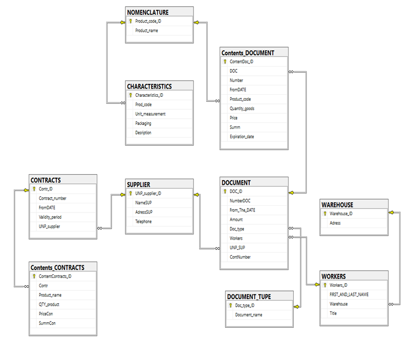

# Схема базы данных: ER-диаграмма и DDL

В этой папке — проектирование базы данных для модуля складского учёта. Схема включает 10 таблиц.

## 🗺️ ER-диаграмма

## 📋 Перечень и описание сущностей (10 таблиц)

Схема разделена на три логических блока: **Справочники**, **Документы** и **Связующие таблицы**.

### 1. Справочники (условно-постоянная информация)

| Сущность (Таблица) | Описание | Ключевые поля |
|---|---|---|
| **WAREHOUSE** (Склады) | Места хранения товаров. | `Warehouse_ID` (PK), `Address` |
| **WORKERS** (Работники) | Сотрудники, закреплённые за складами. | `Workers_ID` (PK), `FIRST_AND_LAST_NAME`, `Warehouse` (FK), `Title` (Должность) |
| **SUPPLIER** (Поставщики) | Контрагенты, поставляющие товар. | `UNP_supplier_ID` (PK), `NameSUP`, `AddressSUP`, `Telephone` |
| **NOMENCLATURE** (Номенклатура) | Справочник товаров (продуктов). | `Product_code_ID` (PK), `Product_name`, `Unit_measurement`, `Packaging`, `Description` |
| **CHARACTERISTICS** (Характеристики) | Характеристики продуктов (например, сорт, цвет, размер, упаковка). | `Characteristic_ID` (PK), `Product_code` (FK), `Characteristic_name` |
| **DOCUMENT_TUPE** (Типы документов) | Классификатор документов: приход, расход, перемещение. | `Doc_type_ID` (PK), `Document_name` |

### 2. Документы (Фиксация операций)

| Сущность (Таблица) | Описание | Ключевые поля |
|---|---|---|
| **DOCUMENT** (Документы) | Шапка документа (накладной). Содержит общую информацию о поставке. | `DOC_ID` (PK), `NumberDoc` (Номер ТТН), `From_The_DATE`, `Amount` (Сумма), `Doc_type` (FK), `Workers` (FK), `UNP_supplier` (FK), `ContNumber` (FK) |
| **CONTRACTS** (Договоры) | Договоры с поставщиками, в рамках которых происходят поставки. | `Contr_ID` (PK), `Contract_number`, `FromDATE`, `Validity_period` (Срок действия), `UNP_supplier` (FK) |

### 3. Связующие таблицы (Детализация, строки документов)

| Сущность (Таблица) | Описание | Ключевые поля |
|---|---|---|
| **Contents_DOCUMENT** (Содержание документа) | Позиции (строки) накладной. Какая номенклатура, в каком количестве и по какой цене пришла. | `ContentDoc_ID` (PK), `DOC` (FK), `Product_code` (FK), `Quantity_goods`, `Price`, `Summ`, `Expiration_date` (Срок годности) |
| **Contents_CONTRACTS** (Содержание договора) | Позиции (строки) договора. Какие товары и в каких объёмах зафиксированы в договоре. | `ContentContracts_ID` (PK), `Contr` (FK), `Product_name`, `QTY_product`, `PriceCon`, `SummCon` |

---

## 🔗 Ключевые связи (Relationships)

- **Один ко многим (1:M):**
  - `WAREHOUSE` → `WORKERS` (на одном складе работает много сотрудников).
  - `WORKERS`→ `DOCUMENT`(один сотрудник может получить много накладных).
  - `SUPPLIER` → `DOCUMENT` (один поставщик может привезти много накладных).
  - `SUPPLIER` → `CONTRACTS` (с одним поставщиком может быть заключено много договоров).
  - `CONTRACTS` → `Contents_CONTRACTS` (в одном договоре много позиций).
  - `DOCUMENT` → `Contents_DOCUMENT` (в одной накладной много позиций).
  - `NOMENCLATURE` → `Contents_DOCUMENT` (один товар может встречаться в разных накладных).
  - `NOMENCLATURE` → `CHARACTERISTICS` (у одного товара может быть несколько характеристик).

## 🛠 DDL-скрипт

Полный скрипт создания таблиц и внешних ключей находится в файле [`ddl.sql`](./ddl.sql). Скрипт написан для MS SQL Server.